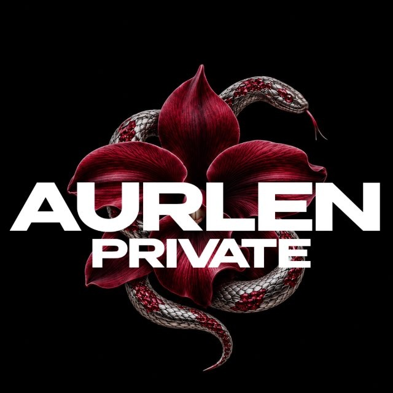

<!DOCTYPE html>
<html lang="ru" data-theme="graphite" data-font="onest-plex">
<head>
  <meta charset="UTF-8" />
  <meta name="viewport" content="width=device-width, initial-scale=1.0, viewport-fit=cover" />
  <meta name="theme-color" content="#0d0e10" />
  <title>AURLEN COMMUNITY</title>
  <link rel="preconnect" href="https://fonts.googleapis.com" />
  <link rel="preconnect" href="https://fonts.gstatic.com" crossorigin />
  <link href="https://fonts.googleapis.com/css2?family=Cormorant:ital,wght@0,500;0,600;0,700;1,500&family=IBM+Plex+Sans:wght@300;400;500;600&family=Inter:wght@300;400;500;600&family=Nunito+Sans:opsz,wght@6..12,400;6..12,600;6..12,700&family=Onest:wght@400;500;600;700&display=swap" rel="stylesheet" />
  
</head>
<body>
  

  <!-- Панель переключения палитры и шрифта -->
  

    

      

        Цвет:
        <button type="button" class="chip-btn active" data-set-theme="graphite">
          1. Графит
        </button>
        <button type="button" class="chip-btn" data-set-theme="obsidian">
          2. Обсидиан
        </button>
        <button type="button" class="chip-btn" data-set-theme="sage">
          3. Шалфей
        </button>
      

      

        Шрифт:
        <button type="button" class="chip-btn active" data-set-font="onest-plex">Onest + IBM Plex</button>
        <button type="button" class="chip-btn" data-set-font="cormorant-inter">Cormorant + Inter</button>
        <button type="button" class="chip-btn" data-set-font="nunito-inter">Nunito + Inter</button>
      

    

  

  <main>
    <!-- ПЕРВЫЙ ЭКРАН -->
    <section class="hero">
      

        Digital &amp; Visual Studio
        <h1 class="hero-title hero-animate delay-1">
          AURLEN
          COMMUNITY
        </h1>
        

          Создаём цельную цифровую упаковку для экспертов, брендов и локальных заведений: разрабатываем современные сайты, функциональных Telegram-ботов и выразительное визуальное оформление каналов под ключ.
        

      

    </section>

    <!-- БЛОК ТГК + ФОТО СПРАВА -->
    <section class="section" id="community">
      

        

          

            Экосистема и комьюнити
            <h2 class="section-title">AURLEN PRIVATE</h2>
            

              В нашем закрытом Telegram-канале мы делимся рабочими процессами, показываем свежие релизы дизайна, разбираем архитектуру ботов и публикуем актуальные условия для запуска проектов.
            

            

              Присоединяйтесь к сообществу, чтобы следить за обновлениями студии и напрямую обсудить задачу под ваш проект.
            

            

              Вход в официальный Telegram-канал сообщества:
              <a href="https://t.me/+ccVZIC5RgEI5MDdi" target="_blank" rel="noopener noreferrer" class="btn-primary">
                Перейти в Telegram-канал
                <svg width="16" height="16" viewBox="0 0 24 24" fill="none" stroke="currentColor" stroke-width="2.2" stroke-linecap="round" stroke-linejoin="round" aria-hidden="true">
                  <path d="M7 17L17 7"></path>
                  <path d="M7 7h10v10"></path>
                </svg>
              </a>
            

          

          

            

              
            

          

        

      

    </section>

    <!-- НАШИ ПРОДУКТЫ (БЕЗ ЦЕН) -->
    <section class="section" id="products">
      

        

          Направления работы
          <h2 class="section-title">Наши Продукты</h2>
        

        

          <!-- Карточка 1 -->
          <article class="card reveal">
            <h3 class="card-title">
              Отдельные заказы
              Single
            </h3>
            <ul class="service-list">
              <li>Создание аватарки</li>
              <li>Создание обоев</li>
              <li>Создание превью</li>
              <li>Создание баннера</li>
              <li>Любая другая графическая и цифровая задача под ваш запрос</li>
            </ul>
          </article>

          <!-- Карточка 2 -->
          <article class="card reveal">
            <h3 class="card-title">
              Комплекты работ
              Packs
            </h3>
            <ul class="service-list">
              <li><strong>Полное оформление:</strong> аватарка, аватарка для адаптера, баннер, обои для ТГК</li>
              <li><strong>Оформление ТГК:</strong> аватарка канала и фирменные обои</li>
              <li><strong>Оформление профиля:</strong> аватарка, аватарка адаптера и баннер</li>
            </ul>
          </article>

          <!-- Карточка 3 -->
          <article class="card reveal">
            <h3 class="card-title">
              Сформируй свой комплект
              Custom
            </h3>
            <ul class="service-list">
              <li>Выбор двух задач в одном заказе — <strong>скидка 20%</strong></li>
              <li>Выбор трёх задач в одном заказе — <strong>скидка 30%</strong></li>
              <li>Четыре и более задачи — <strong>персональная скидка</strong></li>
            </ul>
          </article>

          <!-- Карточка 4 -->
          <article class="card reveal">
            <h3 class="card-title">
              Комплексный запуск
              Synergy
            </h3>
            <ul class="service-list">
              <li>При заказе дизайна ТГК параллельно с разработкой бота или сайта</li>
              <li>При подключении одного смежного эксперта — <strong>скидка 20%</strong></li>
              <li>При подключении двух экспертов — <strong>скидка 30%</strong></li>
              <li><strong>Все скидки суммируются</strong></li>
            </ul>
          </article>

          <!-- Пустой слот для будущих продуктов -->
          <article class="card card-slot reveal">
            <h3 class="card-title">
              Разработка сайтов и Telegram-ботов
              Скоро
            </h3>
            
Место зарезервировано под подробное описание web-разработки и автоматизации.

          </article>

          <article class="card card-slot reveal">
            <h3 class="card-title">
              Дополнительный продукт
              Слот
            </h3>
            
Свободный блок для добавления новых услуг и форматов работы.

          </article>
        

      

    </section>

    <!-- КЕЙСЫ И ПОРТФОЛИО -->
    <section class="section" id="portfolio">
      

        

          Практика и результаты
          <h2 class="section-title">Кейсы и Портфолио</h2>
        

        

          

            Кейс 01
            
Место под разбор проекта: упаковка Telegram-канала

          

          

            Кейс 02
            
Место под разбор проекта: разработка сайта

          

          

            Кейс 03
            
Место под разбор проекта: внедрение Telegram-бота

          

        

        

          

            <h3>Портфолио</h3>
            
Подборка выполненных работ по оформлению каналов, ботам и сайтам.

          

          <a href="#portfolio-link" class="btn-outline" onclick="event.preventDefault();">
            Ссылка на портфолио (добавим позже)
          </a>
        

      

    </section>
  </main>

  <footer class="footer">
    

      AURLEN COMMUNITY &copy; 2026
    

  </footer>

  
</body>
</html>
